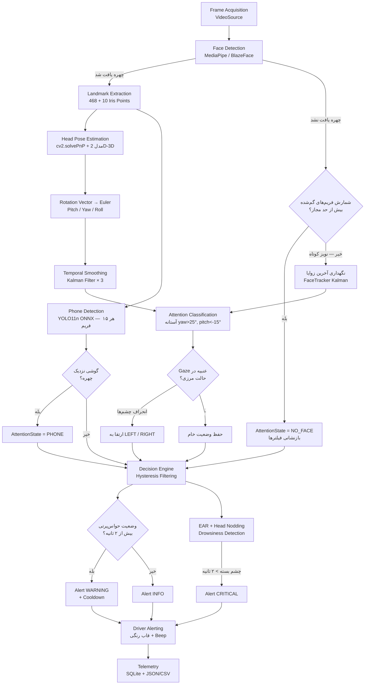

# معماری سیستم (Architecture)

این سند معماری کامل سیستم تشخیص حواس‌پرتی راننده را مستند می‌کند:
نمودار جریان پردازش (Flowchart)، نمودار کلاس‌ها (UML)، جریان داده
بین ماژول‌ها و تصمیم‌های طراحی.

## ۱. نمای کلی

سیستم از دو حلقه تشکیل شده است:

1. **حلقه پردازش (Producer)**: خواندن فریم، اجرای پایپ‌لاین بینایی،
   تولید تصمیم و انتشار خروجی در `SharedState`.
2. **حلقه مصرف (Consumer)**: پنجره OpenCV و داشبورد وب Flask که
   از `SharedState` تغذیه می‌شوند (جداسازی Thread با Lock).

این جداسازی باعث می‌شود سرعت UI هرگز روی نرخ پردازش بینایی اثر
نگذارد — الزام Real-Time مشخصات پروژه (۲۵ تا ۳۰ FPS).

## ۲. نمودار جریان پردازش هر فریم (Flowchart)

## ۳. نمودار کلاس‌ها (UML)

```mermaid
classDiagram
    class DMSConfig {
        +HeadPoseConfig head_pose
        +DetectionConfig detection
        +DrowsinessConfig drowsiness
        +DecisionConfig decision
        +SmoothingConfig smoothing
        +TelemetryConfig telemetry
        +from_json(path) DMSConfig
    }
    class VideoSource {
        +fps: float
        +read() Frame
        +release()
    }
    class FaceDetector {
        +process(frame, ts_ms) FaceObservation
        +close()
    }
    class FaceObservation {
        +landmarks: ndarray~478,3~
        +bbox: tuple
        +model_points_2d() ndarray~6,2~
    }
    class HeadPoseEstimator {
        +estimate(points2d, size) HeadPose
        +reset()
    }
    class HeadPose {
        +angles: EulerAngle
        +reprojection_error: float
        +success: bool
    }
    class FaceTracker {
        +update(bbox, dt) TrackState
        +is_tracking: bool
    }
    class KalmanFilter1D {
        +step(measurement, dt) float
        +value: float
        +reset()
    }
    class AttentionClassifier {
        +classify(angles, landmarks) AttentionResult
    }
    class AttentionState {
        FORWARD
        LEFT / RIGHT
        DOWN / UP
        PHONE
        NO_FACE
    }
    class PhoneDetector {
        +process(frame, ts, face_bbox) list
        +close()
    }
    class DrowsinessDetector {
        +update(ear, pitch, ts) DrowsinessResult
    }
    class DecisionEngine {
        +update(attention, drowsy, ts) Decision
        +episodes: list
        +alert_count: int
    }
    class AlertManager {
        +handle(decision, ts) AlertEvent
        +annotate(frame, decision) ndarray
    }
    class TelemetryStore {
        +log_frame(record)
        +log_alert(record)
        +export_json(path)
        +export_csv(path)
    }
    class DMSPipeline {
        +process(frame, ts_ms) FrameResult
        +close()
    }
    class Dashboard {
        +SharedState shared
        +run(host, port)
    }

    DMSPipeline --> VideoSource : دریافت فریم
    DMSPipeline --> FaceDetector : تشخیص چهره
    DMSPipeline --> PhoneDetector : تشخیص گوشی (هر ۱۵ فریم)
    DMSPipeline --> FaceTracker : ردیابی
    DMSPipeline --> HeadPoseEstimator : زوایای سر
    DMSPipeline --> AttentionClassifier : طبقه‌بندی توجه
    DMSPipeline --> DrowsinessDetector : خواب‌آلودگی
    DMSPipeline --> DecisionEngine : تصمیم
    DMSPipeline --> AlertManager : هشدار
    DMSPipeline --> TelemetryStore : ثبت داده
    FaceTracker --> KalmanFilter1D : هموارسازی جعبه
    DMSPipeline --> KalmanFilter1D : هموارسازی زوایا ×3
    HeadPoseEstimator --> HeadPose : خروجی
    FaceDetector --> FaceObservation : خروجی
    Dashboard --> DMSPipeline : SharedState (غیرمستقیم)
    DMSConfig --> DMSPipeline : پیکربندی
    AttentionClassifier --> AttentionState : خروجی
```

## ۴. جریان داده (Data Flow)

| مرحله | ورودی | خروجی | ماژول |
|---|---|---|---|
| دریافت فریم | منبع ویدیو | `Frame(image, ts, id)` | `video.py` |
| تشخیص چهره | تصویر BGR | `FaceObservation(478×3, bbox)` | `face_detector.py` |
| وضعیت سر | ۶ نقطه 2D | `HeadPose(EulerAngle, err)` | `head_pose.py` |
| هموارسازی | زوایای خام | زوایای کالمن‌شده | `smoothing.py` |
| طبقه‌بندی | زوایا + لندمارک | `AttentionResult(state, ear)` | `attention.py` |
| تشخیص گوشی | فریم (هر ۱۵ فریم) | جعبه‌های گوشی + قاعده نزدیکی چهره | `phone_detector.py` |
| خواب‌آلودگی | EAR + pitch + زمان | `DrowsinessResult` | `drowsiness.py` |
| تصمیم | توجه + خواب‌آلودگی | `Decision(level, message)` | `decision.py` |
| هشدار | تصمیم | قاب حاشیه‌نویسی + Beep | `alerting.py` |
| ثبت | همه خروجی‌ها | رکورد SQLite / JSON / CSV | `telemetry.py` |

## ۵. تصمیم‌های طراحی کلیدی

### چرا SolvePnP و نه CNN (HopeNet/FSA-Net)؟
مشخصات پروژه هر دو مسیر را مجاز دانسته است. روش کلاسیک PnP:
- بدون نیاز به GPU یا مدل سنگین اجرا می‌شود (وبکم/Laptop/Raspberry Pi)؛
- خطای صفر روی داده کنترل‌شده دارد (ارزیابی مصنوعی)؛
- هزینه محاسباتی آن < ۱ms در هر فریم است.
مسیر CNN (HopeNet با ResNet50، FSA-Net، 6DRepNet) برای شرایط
روشنایی سخت و نمای غیرمستقیم دقیق‌تر است و در گزارش به‌عنوان
کار آینده با export به ONNX/TensorRT (FP16/INT8) بحث شده است.

### چرا هیسترزیس؟
طبقه‌بندی لحظه‌ای در حالت‌های مرزی (مثلاً yaw ≈ ۲۵°) نوسان می‌کند.
قاعده «N فریم متوالی» نوسان را حذف و False Alarm را به صفر
می‌رساند — مطابق الزام «False Alarm با Hysteresis Filtering» در
مشخصات پروژه.

### چرا فیلتر کالمن سه‌گانه؟
هر زاویه مدل مستقل `[position, velocity]` دارد؛ سرعت تخمینی به
حل فوری نوسان‌ها کمک می‌کند و تأخیر فاز نسبت به میانگین متحرک
کمتر است. `MovingAverage` نیز به‌عنوان پشتیبان پیاده‌سازی شده
تا مقایسه امکان‌پذیر باشد.

### چرا چرخش سر به چپ/راست هشدار ندارد؟
راننده در جریان رانندگی موظف است آینه داخلی، آینه‌های کناری،
گذرها و هنگام پیچ، طرفین را ببیند؛ بنابراین `LEFT`/`RIGHT` حواس‌پرتی
نیستند و فقط برچسب اطلاع‌رسانی INFO می‌گیرند. هشدار واقعی برای
رفتارهای بی‌دلیل خطرناک رزرو شده است: نگاه به پایین (موبایل)،
گوشی نزدیک چهره (PHONE)، نبود چهره در کادر (NO_FACE) و
خواب‌آلودگی. برای ناوگان‌های با سیاست سخت‌گیرانه، گزینه
`lateral_alert_enabled` رفتار قبلی را برمی‌گرداند. تفکیک «نگاه به
آینه» از «خیره شدن به کناره» بدون سیگنال‌های خودرو (راهنما،
فرمان) در حد تفسیر قاعده‌محور ممکن نیست و به کارهای آینده
(اتصال CAN bus) موکول شده است.

### چرا YOLO11n ONNX برای تشخیص گوشی؟
مدل Object Detector داخلی MediaPipe (EfficientDet-Lite) به متادیتای
TFLite Model Metadata وابسته است و مدل بدون متادیتا بارگذاری نمی‌شود؛
به‌جای آن، YOLO11n (کوچک‌ترین نسخه Ultralytics) در قالب ONNX با
ONNX Runtime — که در فهرست فناوری‌های الزامی پروژه است — پیاده‌سازی
شد: بدون وابستگی به torch، با ورودی دینامیک (۳۲۰×۳۲۰ برای سرعت) و
NMS داخلی. برای حفظ Real-Time، تشخیص هر ۱۵ فریم اجرا و نتیجه با
hold نگه داشته می‌شود (میانگین ≈ ۱۲ms اضافه در هر فریم).

### مدیریت چهره گم‌شده
دو سطح تفکیک شده است:
- **گم شدن کوتاه (< ۱۰ فریم)**: ردیاب آخرین وضعیت را نگه می‌دارد
  (رفع نویز پلک زدن مدل تشخیص) — بدون تغییر وضعیت توجه؛
- **گم شدن طولانی**: وضعیت `NO_FACE` اعلام و فیلترها بازنشانی
  می‌شوند (راننده خارج از کادر / پوشش صورت).

### سناریوی سخت‌افزاری هدف
مطابق مشخصات پروژه، علاوه بر وبکم لپ‌تاپ، اجرا روی Raspberry Pi
(به‌عنوان ماژول DMS پس از داشبورد Dashcam و در سطح ADAS Level-1/2)
در نظر گرفته شده است: کل پردازش هسته CPU-only است و Telemetry
با SQLite دسترسی هم‌زمان ایمن است. ارسال وضعیت به سرویس‌های IoT
از طریق خروجی JSON/CSV انجام می‌شود.
